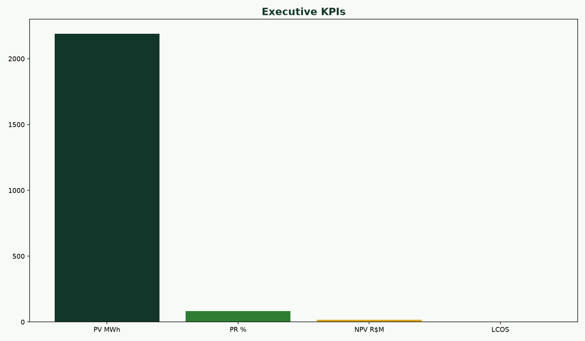
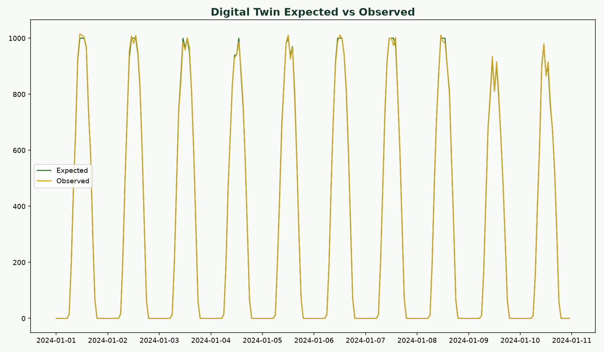
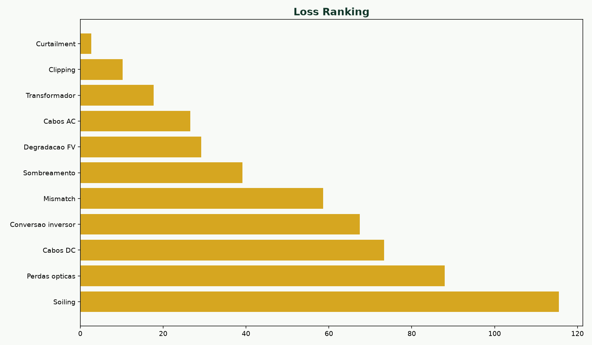
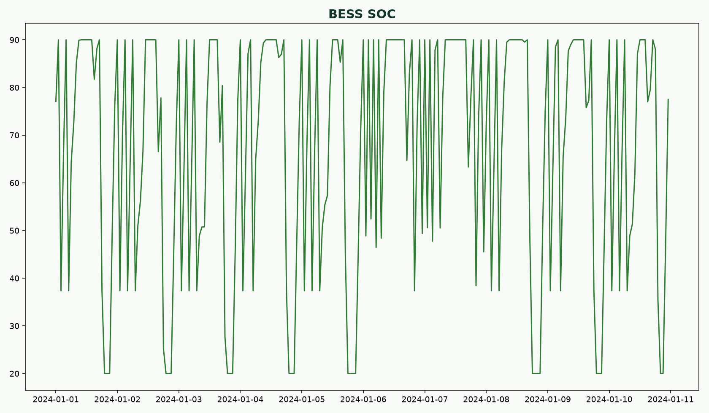

# Gêmeo Digital Fotovoltaico & Otimização BESS
### *Solar PV Digital Twin & BESS Optimization Platform*

[](https://luscaarmstrong1.github.io/solar-pv-digital-twin-bess-platform/)
[](https://lucas-santos-portfolio-zeta.vercel.app/)
[](https://www.linkedin.com/in/lucasssantos1/)
[](https://github.com/luscaarmstrong1/solar-pv-digital-twin-bess-platform)

> **Camada 01 • Ecossistema de Engenharia, Energia, Dados & Automação**
> Modelagem física de 1,20 MWp, monitoramento horário Expected vs. Observed, árvore de perdas O&M e despacho ótimo de baterias (250 kW / 750 kWh).

---

## Acesse o Simulador Interativo e Demonstração Online

- **Simulador Paramétrico Web (GitHub Pages):** [https://luscaarmstrong1.github.io/solar-pv-digital-twin-bess-platform/](https://luscaarmstrong1.github.io/solar-pv-digital-twin-bess-platform/)
- **Vitrine no Portfólio Principal:** [https://lucas-santos-portfolio-zeta.vercel.app/#arquitetura](https://lucas-santos-portfolio-zeta.vercel.app/#arquitetura)

---

## Visão Geral e Problema de Engenharia

Plataforma analítica de gêmeo digital fotovoltaico (1,20 MWp), diagnóstico operacional O&M, decomposição de perdas e otimização técnico-econômica de armazenamento BESS (250 kW / 750 kWh) em Python, pvlib, FastAPI e Streamlit.

### Indicadores-Chave do Projeto (Caso-Base)

| Indicador Técnico | Resultado / Escopo | Detalhamento de Engenharia |
| :--- | :--- | :--- |
| **Planta Fotovoltaica** | `1,20 MWp` | Modelagem física horária AC/DC |
| **Sistema BESS** | `250 kW / 750 kWh` | Controle de SOC & arbitragem |
| **Performance Ratio** | `82,4%` | Rastreamento Expected vs Observed |
| **Árvore de Perdas** | `6 Camadas` | Térmica, sujidade, clipping e O&M |

---

## Arquitetura do Sistema e Fluxo de Modelagem

1. **Etapa 01:** Recurso Solar & Telemetria Horária (GHI, DNI, Temperatura Ambiente e Vento)
2. **Etapa 02:** Gêmeo Digital Físico FV (Transposição POA, Temperatura de Célula, Inversor e Clipping)
3. **Etapa 03:** Diagnóstico de Performance & O&M (Árvore de Perdas, Detecção de Falhas e Strings)
4. **Etapa 04:** Despacho Inteligente BESS & Viabilidade (Peak Shaving, Arbitragem Tarifária, LCOS e VPL)

---

## Fundamentação Física, Matemática e Regulatória

### 1. Potência CC e Correção Térmica
```text
P_DC(t) = P_STC · (G_POA(t) / 1000) · [1 + γ · (T_cell(t) - 25°C)]
```

### 2. Dinâmica de Estado de Carga (SOC BESS)
```text
SOC(t+1) = SOC(t) + [η_ch · P_ch(t) - P_dis(t) / η_dis] · (Δt / E_nom)
```

### 3. Levelized Cost of Storage (LCOS)
```text
LCOS = [CAPEX_BESS + Σ (OPEX_t + C_ch,t) / (1+r)^t] / [Σ E_dis,t / (1+r)^t]
```

---

## Painéis Analíticos e Evidências Visuais

### Visão Executiva da Usina & KPIs


### Gêmeo Digital: Esperado vs. Observado


### Decomposição da Árvore de Perdas


### Operação e Estado de Carga BESS


---

## Como Executar Localmente

```bash
# 1. Clone o repositório
git clone https://github.com/luscaarmstrong1/solar-pv-digital-twin-bess-platform.git
cd solar-pv-digital-twin-bess-platform

# 2. Instale as dependências e execute a suíte analítica
pip install -r requirements.txt
python scripts/run_all.py
pytest
streamlit run dashboard/streamlit_app.py
```

> **Nota Técnica:** Este projeto utiliza modelagem determinística auditável e séries sintéticas estruturadas para demonstração de arquitetura de engenharia elétrica, ciência de dados e tomada de decisão técnico-econômica. Não substitui projeto executivo, parecer de acesso da concessionária ou emissão de ART específica de campo.

---

## Autor e Responsável Técnico

**Lucas Silva Santos**
*Engenheiro Eletricista & Gerente de Projetos*
Energia • Dados • Inteligência Artificial • Automação • São João da Boa Vista, SP • Itajubá, MG

- **Portfólio:** [https://lucas-santos-portfolio-zeta.vercel.app/](https://lucas-santos-portfolio-zeta.vercel.app/)
- **LinkedIn:** [linkedin.com/in/lucasssantos1](https://www.linkedin.com/in/lucasssantos1/)
- **GitHub:** [@luscaarmstrong1](https://github.com/luscaarmstrong1)
