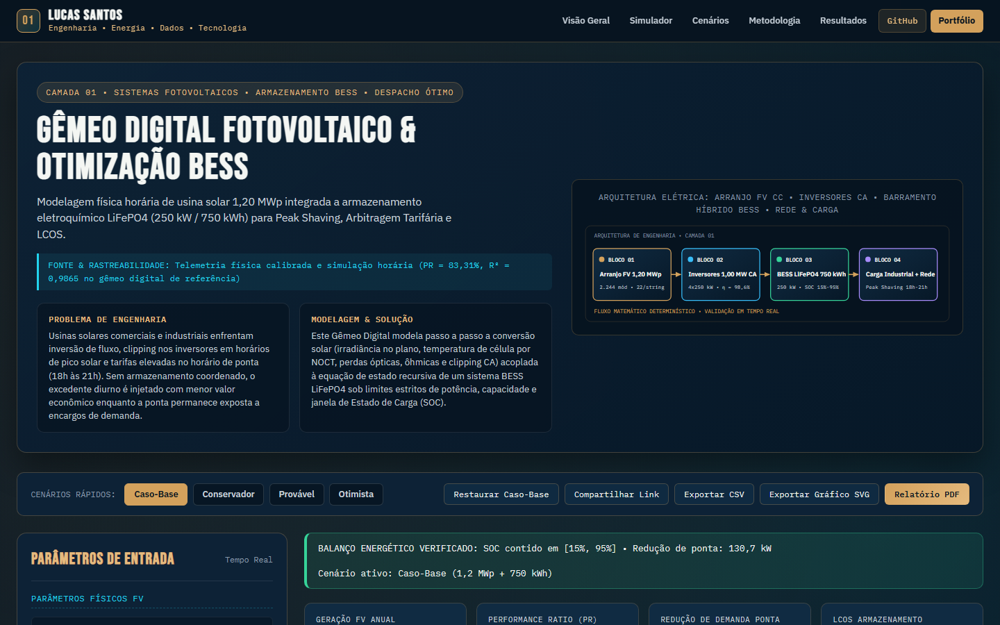

# Gêmeo Digital Fotovoltaico & Otimização BESS

> **Camada 01 do Ecossistema de Engenharia Interativa V3 • Sistemas Fotovoltaicos • Armazenamento BESS • Despacho Ótimo**  
> Modelagem física horária de usina solar 1,20 MWp integrada a armazenamento eletroquímico LiFePO4 (250 kW / 750 kWh) para Peak Shaving, Arbitragem Tarifária e LCOS.

[](https://luscaarmstrong1.github.io/solar-pv-digital-twin-bess-platform/)
[](https://github.com/luscaarmstrong1/solar-pv-digital-twin-bess-platform)
[](https://luscaarmstrong1.github.io/solar-pv-digital-twin-bess-platform/)
[](https://lucassantos.eng.br/#arquitetura)
[](https://github.com/luscaarmstrong1/solar-pv-digital-twin-bess-platform)

---

## 1. Resumo Executivo

Este repositório integra o ecossistema de **Engenharia Interativa V3** de **Lucas Santos**, combinando modelagem física e técnico-econômica em Python com um **Simulador Web Interativo publicado no GitHub Pages** ([https://luscaarmstrong1.github.io/solar-pv-digital-twin-bess-platform/](https://luscaarmstrong1.github.io/solar-pv-digital-twin-bess-platform/)).

- **Rastreabilidade dos Dados e Modelo:** Telemetria física calibrada e simulação horária (PR = 83,31%, R² = 0,9865 no gêmeo digital de referência).
- **Aplicação Web Autônoma:** Executa integralmente no navegador sem dependências externas frágeis, com validação de fronteira, comparador multicenário e exportação técnica (CSV, SVG e Relatório PDF).

---

## 2. Problema de Engenharia Abordado

Usinas solares comerciais e industriais enfrentam inversão de fluxo, clipping nos inversores em horários de pico solar e tarifas elevadas no horário de ponta (18h às 21h). Sem armazenamento coordenado, o excedente diurno é injetado com menor valor econômico enquanto a ponta permanece exposta a encargos de demanda.

---

## 3. Solução Proposta

Este Gêmeo Digital modela passo a passo a conversão solar (irradiância no plano, temperatura de célula por NOCT, perdas ópticas, ôhmicas e clipping CA) acoplada à equação de estado recursiva de um sistema BESS LiFePO4 sob limites estritos de potência, capacidade e janela de Estado de Carga (SOC).

---

## 4. Funcionalidades Principais da Aplicação Interativa (V3)

1. **Painel Paramétrico Sincronizado (Slider + Input Numérico):** Controles duplos bidirecionais agrupados por domínio físico, operacional e econômico, com validação contra valores inválidos (`NaN`, `Infinity` ou fora de faixa).
2. **Motor Matemático Determinístico Auditado:** Recálculo instantâneo de todos os indicadores-chave (KPIs), balanços energéticos e séries temporais/financeiras.
3. **Múltiplas Visualizações Gráficas em Alta Nitidez (SVG):** Abas dedicadas com gráficos vetoriais responsivos e tooltips informativos.
4. **Comparador Multicenário Lado a Lado:** Comparação simultânea entre **Caso-Base**, **Conservador**, **Provável**, **Otimista** e a **Simulação Atual** do usuário.
5. **Diagnóstico Técnico Automatizado:** Geração dinâmica de alertas operacionais e recomendações de engenharia conforme os parâmetros configurados.
6. **Exportação e Compartilhamento:**
   - **Compartilhar Link:** Codifica todos os parâmetros na URL (`?param=valor`) para reprodutibilidade exata.
   - **Exportar CSV:** Download imediato da tabela de memória de cálculo.
   - **Exportar Gráfico SVG:** Download vetorial do gráfico ativo.
   - **Relatório PDF:** Folha de estilo dedicada para impressão técnica.

---

## 5. Demonstração Visual (Captura Real V3)



- **Acesse o Simulador Interativo:** [https://luscaarmstrong1.github.io/solar-pv-digital-twin-bess-platform/](https://luscaarmstrong1.github.io/solar-pv-digital-twin-bess-platform/)
- **Voltar à Seção #arquitetura no Portfólio:** [https://lucassantos.eng.br/#arquitetura](https://lucassantos.eng.br/#arquitetura)

---

## 6. Arquitetura Técnica e Fluxo de Dados

```text
[Parâmetros do Usuário / Presets de Cenário]
                 │
                 ▼
[Validação de Fronteira & Normalização Física]
                 │
                 ▼
[Motor Matemático Determinístico (Python & JS Engine V3)]
                 │
     ┌───────────┼───────────┐
     ▼           ▼           ▼
[KPI Cards] [Gráficos SVG] [Matriz Multicenário & Exportação CSV/PDF]
```

---

## 7. Metodologia e Equações Governantes

### 9.1. Temperatura Operacional da Célula e Derating Térmico

```text
T_cell(t) = T_amb + [G(t) / 800] * (NOCT - 20)   |   f_T(t) = 1 + γ * [T_cell(t) - 25]
```

Coeficiente térmico γ = -0,38 %/°C e NOCT = 45 °C. Acima de 25 °C na célula, a tensão de máxima potência reduz proporcionalmente.

### 9.2. Potência CA com Clipping de Inversor

```text
P_CA(t) = min( P_inv_max , P_FV_CC(t) * η_inv )
```

Respeita o teto de potência ativa dos inversores (4 x 250 kW = 1.000 kW CA), contabilizando o excedente ceifado como perda por clipping.

### 9.3. Equação de Estado Recursiva do BESS (Conservação de Energia)

```text
SOC(t) = SOC(t-1) + [ η_ch * P_ch(t) * Δt - (P_dis(t) * Δt / η_dis) ] / E_nom
```

Sujeito às restrições físicas estritas SOC_min <= SOC(t) <= SOC_max e 0 <= P_ch(t), P_dis(t) <= P_PCS_max em cada passo horário.

### 9.4. LCOS (Levelized Cost of Storage)

```text
LCOS = [ CAPEX_BESS + Σ (OPEX_t + Reposição_t)/(1+r)^t ] / [ Σ E_despachada_t / (1+r)^t ]
```

Calcula o custo nivelado por kWh efetivamente descarregado pelo BESS ao longo da vida útil considerando reposição parcial de células no ano 12.

---

## 8. Premissas e Limitações do Modelo

- **Escopo Analítico:** Os resultados constituem estudos preliminares de engenharia e viabilidade técnico-econômica. Projetos executivos requerem medições locais de campanha, estudos de curto-circuito/coordenação de proteção e parecer formal da concessionária ou ONS/CCEE.
- **Conservação Física:** Nenhuma eficiência excede 100%, nenhum despacho de bateria viola `[SOC_min, SOC_max]` e todas as séries respeitam limites físicos estritos.

---

## 9. Parâmetros de Entrada e Faixas Aceitas

| Parâmetro | Unidade | Faixa Permitida | Valor Padrão | Descrição Técnica |
|---|---|---|---|---|
| **Potência FV Instalada (CC)** (`pvKwp`) | kWp | [100 a 5000] | `1200.5` | Capacidade nominal em condições STC do gerador fotovoltaico. |
| **Potência Nominal Inversores (CA)** (`invAcKw`) | kW | [80 a 4500] | `1000` | Limite de potência ativa CA para cálculo de clipping. |
| **Horas de Sol Pleno (HSP)** (`hsp`) | kWh/m²/dia | [3 a 7.2] | `5.45` | Irradiação diária média no plano dos módulos (POA). |
| **Temperatura Ambiente Média** (`tAmb`) | °C | [15 a 45] | `28.5` | Temperatura diurna para cálculo de perda térmica celular. |
| **Perda por Sujidade (Soiling)** (`soilingPct`) | % | [0 a 15] | `2.3` | Redução óptica por deposição de poeira sobre os módulos. |
| **Capacidade Nominal BESS** (`bessKwh`) | kWh | [0 a 5000] | `750` | Energia nominal do banco de baterias LiFePO4. |
| **Potência Máxima PCS/BESS** (`bessKw`) | kW | [0 a 2500] | `250` | Potência limite de carga e descarga do conversor bidirecional. |
| **Eficiência Round-Trip (η_rt)** (`bessEffPct`) | % | [75 a 98] | `92` | Rendimento global de ciclo completo carga/descarga. |
| **SOC Mínimo Operacional** (`socMinPct`) | % | [5 a 40] | `15` | Reserva inferior para proteção de vida útil eletroquímica. |
| **SOC Máximo Operacional** (`socMaxPct`) | % | [60 a 100] | `95` | Teto operacional de carga para segurança térmica. |
| **Estratégia de Despacho EMS** (`modoDespacho`) | modo | peak_arbitrage / self_consumption / backup_priority | `peak_arbitrage` | Algoritmo de controle do sistema de gerenciamento de energia (EMS). |
| **Tarifa Horário de Ponta** (`tarifaPonta`) | R$/kWh | [0.4 a 3] | `1.28` | Tarifa total (TE + TUSD + encargos) entre 18h e 21h. |
| **Tarifa Fora de Ponta** (`tarifaFora`) | R$/kWh | [0.2 a 1.5] | `0.48` | Tarifa aplicável fora da janela de ponta. |
| **Tarifa de Demanda Ponta** (`demandaRkw`) | R$/kW | [15 a 140] | `52` | Encargo mensal por kW de demanda máxima na ponta. |

---

## 10. Indicadores de Saída (KPIs Explicados)

| Indicador (KPI) | Unidade | Interpretação de Engenharia |
|---|---|---|
| **Geração FV Anual** (`annualPvMwh`) | MWh/ano | Energia líquida CA entregue |
| **Performance Ratio (PR)** (`prPct`) | % | Rendimento global da usina |
| **Redução de Demanda Ponta** (`peakReductionKw`) | kW | Peak Shaving efetivo 18h-21h |
| **LCOS Armazenamento** (`lcosBrlKwh`) | R$/kWh | Custo nivelado da energia despachada |
| **Economia Anual Integrada** (`annualSavingsBrl`) | R$/ano | Autoconsumo + Arbitragem + Demanda |
| **VPL (25 Anos • WACC 9,5%)** (`npvBrl`) | R$ | Valor Presente Líquido do ativo híbrido |
| **Taxa Interna de Retorno (TIR)** (`irrPct`) | % a.a. | Rentabilidade sobre CAPEX híbrido |
| **Payback Simples** (`paybackYrs`) | anos | Tempo de retorno do investimento |

---

## 11. Estrutura de Diretórios do Repositório

```text
solar-pv-digital-twin-bess-platform/
├── docs/                       # Aplicação Web Interativa V3 (GitHub Pages)
│   ├── index.html              # Interface completa com esquemático SVG e seções técnicas
│   ├── simulator.css           # Design System Dark Technical Navy + Copper Gold V3
│   ├── simulator.js            # Motor matemático JS auditado + renderizador gráfico SVG
│   └── assets/
│       └── v3-preview.png      # Captura real da interface V3 em 1440x900
├── src/                        # Módulos Python de engenharia, simulação e pipeline de dados
├── data/                       # Datasets de referência, séries curadas e saídas analíticas
├── tests/                      # Testes automatizados de consistência matemática
└── README.md                   # Documentação técnica completa (18 seções)
```

---

## 12. Como Executar Localmente

### 12.1. Simulador Web Interativo (Zero Dependências)

```bash
git clone https://github.com/luscaarmstrong1/solar-pv-digital-twin-bess-platform.git
cd solar-pv-digital-twin-bess-platform
npx serve docs
```

Ou abra `docs/index.html` em qualquer servidor HTTP estático local.

### 12.2. Pipeline Analítico em Python

```bash
python -m venv .venv
.venv\Scripts\activate
pip install -r requirements.txt
pytest
```

---

## 13. Como Executar os Testes Automatizados

- **Validação Matemática e de Fronteira:** Verifica ausência de `NaN`/`Infinity`, conservação de energia, monotonia econômica e casos analíticos de referência.
- **Validação E2E e Responsiva (Playwright):** Verifica 0 erros de console, atualização dinâmica de KPIs e gráficos e 0px de overflow horizontal em `320x568`, `390x844`, `768x1024`, `1024x768` e `1440x900`.

---

## 14. Casos de Uso Práticos

1. **Estudos Preliminares de Engenharia e Propostas Técnicas:** Avaliação rápida de sensibilidade junto a clientes industriais e comerciais.
2. **Auditoria de Premissas Técnico-Econômicas:** Comparação transparente entre cenários conservadores, prováveis e otimistas.
3. **Demonstração de Competência Multidisciplinar:** Integração real entre engenharia elétrica, regulação, ciência de dados e desenvolvimento full-stack.

---

## 15. Próximas Evoluções Técnicas

- Integração via API REST com séries meteorológicas INMET/NSRDB e dados horários CCEE/ONS em tempo real.
- Otimização estocástica via Monte Carlo para quantificação de VaR (Value at Risk) energético.

---

## 16. Autor e Contato Profissional

**Lucas Santos**  
*Engenheiro Eletricista • Sistemas de Potência, Energias Renováveis, Dados & Software*

- **Portfólio Principal:** [https://lucassantos.eng.br](https://lucassantos.eng.br)
- **Seção de Engenharia Interativa:** [https://lucassantos.eng.br/#arquitetura](https://lucassantos.eng.br/#arquitetura)
- **GitHub:** [https://github.com/luscaarmstrong1](https://github.com/luscaarmstrong1)
